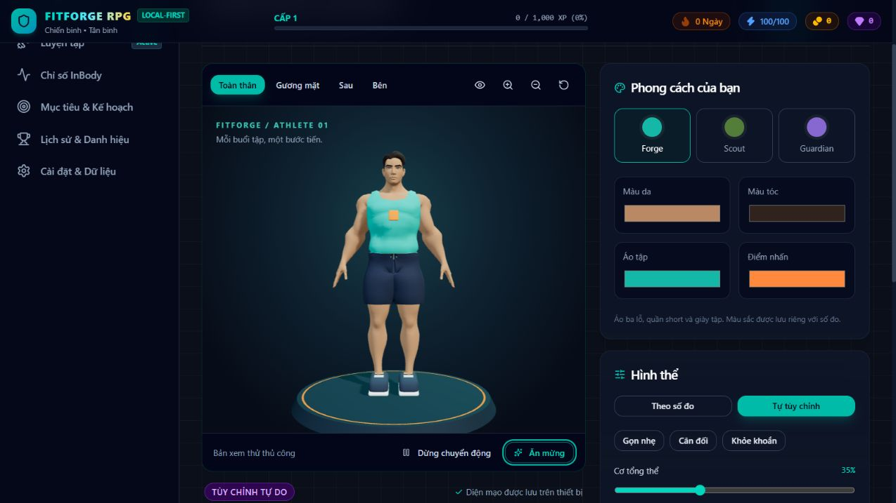

# Nhân vật gym hoạt hình — bản đầu

Triển khai ngày 22/10/2026 trên nhánh `codex/stylized-gym-character`.

## Kết quả

Nhân vật mới dùng trên trang Nhân vật và Tổng quan: tóc ngắn, mặt có mắt/mi, áo ba lỗ, quần short, giày đế sáng và điểm nhấn cam. Có bộ xương, idle/thở nhẹ, chớp mắt, động tác ăn mừng bằng rig, tạm dừng chuyển động và góc nhìn toàn thân/mặt/sau/bên. Tôn trọng tùy chọn giảm chuyển động khi mở viewer.

Bốn shape keys `Muscle`, `BodyFat`, `Chest`, `Legs` được tạo cùng trường biến dạng trên da, áo và quần; `Blink` dùng cho mặt/mắt. Hệ thống đọc các morph theo tên trên tất cả mesh, nội suy khi thay đổi và tạo skeleton/material riêng cho từng bản xem. Ba preset hình thể và ba bảng màu; có thể đổi màu da/tóc/áo/điểm nhấn. Chỉ số phần trăm trên thanh trượt là cường độ hình ảnh, không phải phần trăm mỡ đo được.

Theo số đo/mục tiêu: giữ bộ ánh xạ thành phần cơ thể hiện có và chuyển các proxy sang bốn morph. Bản thủ công giữ riêng `currentBody`/`goalBody`. XP không tham gia ánh xạ. Hai mốc lịch sử có thể xem cạnh nhau; dữ liệu đo không bị sửa bởi thao tác xem. Hình thể/diện mạo dùng IndexedDB và cơ chế sao lưu hiện có; màu tóc là trường tùy chọn được kiểm tra định dạng. Cấu hình macro MPFB trong localStorage cũ không được đọc vào model mới.

## Asset và giấy phép

- Base: **Quaternius Universal Base Characters — Standard**, tải từ [trang tác giả](https://quaternius.itch.io/universal-base-characters), ngày 22/10/2026.
- Bản miễn phí thực tế có Superhero Male/Female, không có Regular; bản này dùng Superhero Male, làm gọn nhẹ thân và tạo mới trang phục/giày/shape keys. Không mua gói Source.
- Tóc: Hair SimpleParted; mắt và chân mày từ cùng gói.
- Asset gốc CC0; giữ nguyên giấy phép tại `AI_Character_Studio/source/QUATERNIUS_LICENSE.txt` và `public/models/QUATERNIUS_LICENSE.txt`.
- Source tự tạo từ các asset được phép chỉnh: `AI_Character_Studio/source/fitforge_athlete.blend`, texture đã pack.
- Runtime: `public/models/fitforge_athlete.glb`, toàn bộ tài nguyên được nhúng, không tải CDN khi chạy.
- Model ID: `fitforge-athlete-v1`. Các tham số hình thể đã lưu là proxy ngữ nghĩa, không phải chỉ số morph theo thứ tự trong file.

## Sửa và xuất tiếp

Blender portable 4.5.9 LTS được lấy từ máy chủ chính thức và đặt trong `.tools/` (Git bỏ qua), không cài hệ thống.

```powershell
# Xuất lại từ nguồn đã pack, không cần gói tải gốc:
& '.tools/blender-4.5.9-windows-x64/blender.exe' --background --python AI_Character_Studio/scripts/export_athlete.py

# Tạo ảnh trước/sau và stress test các morph từ .blend:
& '.tools/blender-4.5.9-windows-x64/blender.exe' --background --python AI_Character_Studio/scripts/preview_athlete.py
```

`build_gym_hero.py` tái dựng từ gói Standard đã giải nén vào `AI_Character_Studio/vendor/quaternius/Universal Base Characters[Standard]`. `vendor/` và `.tools/` không nằm trong Git. File .blend đóng gói sẵn đủ để chỉnh và xuất lại mà không có hai thư mục này.

## Kiểm tra

- `npm.cmd run test`: 173/173 test đạt, 13 file.
- `npm.cmd run lint`: đạt, không có cảnh báo lint.
- `npm.cmd run build`: TypeScript/Vite đạt; còn cảnh báo bundle lớn như bên dưới.
- `git diff --check`: đạt.

- Model: 1.392.072 byte (~1,39 MB), 17.483 tam giác, 19 mesh, 65 khớp, 1 texture nhúng, clip Idle.
- Test hợp đồng asset: GLB đúng chiều dài/header, không tham chiếu tài nguyên ngoài, normals và skin weights, có Idle và texture mắt; da/áo/quần có đủ bốn morph.
- Test ánh xạ: phiếu sau tăng cơ/giảm mỡ làm đổi đúng proxy; dữ liệu gốc không bị sửa; đầu vào hỏng được giới hạn hữu hạn; hồ sơ cũ và trường màu tóc mới hợp lệ.
- Render Blender: ảnh trước/sau, góc 3/4 và trường hợp bốn morph cùng mức 1. Đây là kiểm tra hình ảnh, không phải chứng nhận giải phẫu hoặc kiểm thử tất cả tổ hợp.
- Trình duyệt trên máy: tải model, toàn thân và mặt, chân/giày trên bệ, đổi preset/màu, lưu lại, góc camera và các điều khiển cơ bản. Không thêm phiếu đo hoặc buổi tập giả vào dữ liệu người dùng.
- Chưa benchmark FPS hoặc chứng nhận trên điện thoại thực. Giới hạn DPR 1–1,5; dung lượng và số tam giác nằm trong mục tiêu bản đầu.

## Phạm vi bản đầu và bước sau

Bản đầu cung cấp một nhân vật và một bộ đồ tập. Chưa có nhân vật nữ hoặc nhiều kiểu tóc/trang phục có thể đổi; chưa có hoạt cảnh tập tạ/squat cần tiếp xúc tay với dụng cụ. Bộ tăng cơ là biến dạng nghệ thuật có giới hạn, chưa có shape key chuyên sâu từng bó cơ. Có thể tiếp tục tinh chỉnh đường may/độ ôm trang phục ở những tổ hợp morph mạnh và phát triển các preset mềm mại hơn.

Vite còn cảnh báo bundle ứng dụng lớn và Three.js còn cảnh báo deprecation từ thư viện hiện có; tách bundle và nâng cấp renderer có thể làm riêng sau.


