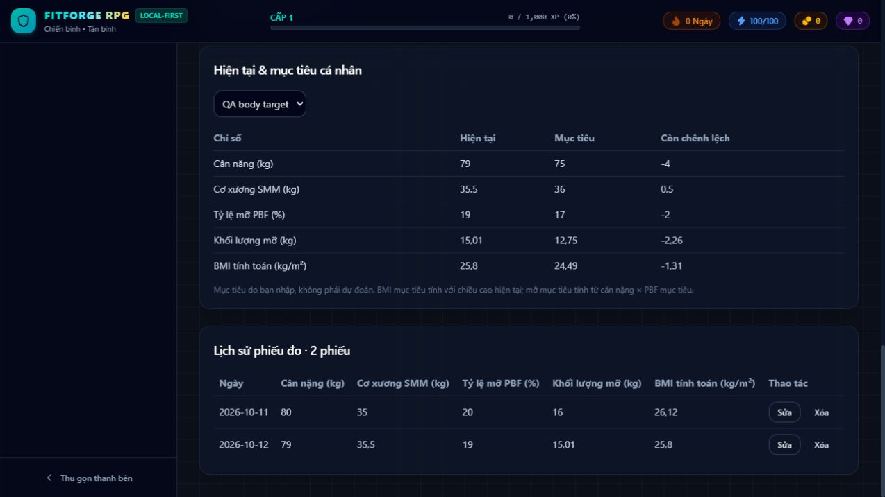

# Phase 3 Report — InBody & Body Composition Engine

Completed on 2026-10-12 in `D:\RPG`.

- Branch: `feature/phase-3-inbody-engine`, created from local `main` at Phase 2 commit `0b72284`.
- Implementation commit: `42857f3a4f6c1a09d246ab81a5b4d322b6f0dd6b` — **Implement Phase 3 local body composition engine and InBody history**.
- This report is committed separately after the implementation so it can record its exact hash. The branch includes both commits.
- No push or merge performed. Phase 4 has not started. No dependencies added.

## Repository audit

The working tree was clean on `main` before development. Architecture, handoff and Phase 2 report were read; domain types, Zustand stores, Dexie schema/validation/backups, pages, shared UI and procedural avatar were inspected. Baseline lint/build passed, and all 39 Phase 2 tests passed.

The existing implementation already provided persistent workouts, draft recovery, PRs, profile progression, safe additive restoration and demo provenance. Body measurement entry was basic: missing optional readings were rejected, height was absent, BMI was only a report field, there was no measurement edit/delete UI or dedicated transaction, no independent reference classification and no body-to-avatar mapping. The History page had a combined weight/SMM chart; the Character page kept manual proportions. Scaffold fixtures remained only as legacy/demo recognition and exercise metadata; no new body measurements are seeded.

## Features implemented

1. Measurement creation and editing with date, height, weight, SMM, PBF, reported body-fat mass and explicit unavailable core values. Optional BMR, visceral fat, water, bone minerals, score, measurement-age, segmental kg/percent and report references persist independently. A wholly empty report is rejected. Invalid finite types, units, dates, bounds, unknown fields and malformed intervals fail before writes.
2. Confirmed deletion of the selected measurement. Measurement create/edit/delete operations and audit entries commit atomically. Failed edits/deletes roll back; deleted reports cannot be resurrected by a stale edit; demo reports cannot become real records through the editing service.
3. BMI, calculated body-fat mass and fat-free mass with explicit provenance. Original reported BMI/fat mass are preserved separately. SMM is never inferred from BMI. Missing height prevents calculated BMI rather than inventing one.
4. Current-versus-previous differences for weight, SMM, PBF, reported fat mass and calculated BMI. Unavailable comparisons stay unavailable. History is chronological with deterministic same-date ID ties.
5. Independent low/normal/high classifications only when a valid, metric-specific report interval exists. Boundaries are inclusive; missing references yield unclassified. Adult intervals do not apply below 18 or with unknown age. UI shows the actual reading, interval/source explanation and nonmedical context separately from RPG level.
6. Body overview, four separate history charts (weight/SMM/PBF/BMI), segmental lean diagram with relative mass bars, actual history table, create/edit forms, reference controls, delete confirmation and current-target table. Missing chart readings create gaps. Date input changes remain committed when another field is edited.
7. `BodyCompositionToAvatar` v1 supplies normalized volume, upper/lower representation, fat and limb/trunk parameters, safe renderer dimensions and missing-input metadata. Artistic scales are documented in [BODY_COMPOSITION.md](BODY_COMPOSITION.md). Current/goal mappings are distinct derived state and never overwrite manual proportions, equipment or other character customization. Segmental lean is treated as lean tissue, not exact muscle size. Advanced morphing is deferred.
8. Live body data connects Dashboard, Body Analysis, History, Goals and Character. Goal comparison uses user-entered targets; target BMI and fat mass are explicitly calculated, not physical-change predictions. Active goal selection is shared session state. Nutrition targets remain user entries; no restrictive recommendations are generated.
9. Dexie version 3 adds only a body-source index, preserving original readings and legacy height absence. JSON export version 3 includes reports/references and accepts v1/v2/v3 restores, using dedicated body validation with the established atomic, additive conflict behavior. Existing IDs win. Derived mappings/calculations are recomputed rather than backed up as actual readings.
10. Phase 2 workout/PR calculations, stores and procedural rendering modules remain intact. No cloud, OCR, external AI API, medical diagnosis or automatic user-data reset was added.

## Files created and modified

| Files | Change |
| --- | --- |
| `src/types/inbody.ts` | Nullable reported readings, height, age, report references and versioned input contract |
| `src/services/bodyComposition/calculations.ts` | Null-safe formulas, provenance, comparison and reference classifications (new) |
| `src/services/bodyComposition/validation.ts` | Dedicated runtime report validation (new) |
| `src/services/bodyComposition/BodyCompositionToAvatar.ts` | Versioned artistic current/goal mapping and goal-input adapter (new) |
| `src/services/bodyComposition/presentation.ts` | Shared Vietnamese metric labels and missing-value formatting (new) |
| `src/services/bodyComposition/calculations.test.ts` | 58 formula/validation/classification/mapping tests (new) |
| `src/services/db/bodyMeasurements.test.ts` | 8 transaction/persistence/backup/migration tests (new) |
| `src/services/db/db.ts` | Safe v3 index, measurement transactions/audits, v3 export and older backup acceptance |
| `src/services/db/validation.ts` | Routes reports through their dedicated validator |
| `src/services/db/DatabaseSync.tsx` | Consistent live measurement/goal hydration and independent mapping state |
| `src/stores/useInBodyStore.ts` | Persistent measurement edit and transactional create/delete |
| `src/stores/useCharacterStore.ts` | Independent derived current/goal mapping state and session goal selection |
| `src/components/BodyComposition.tsx` | Shared overview, four charts, target comparison and goal selector (new) |
| `src/pages/BodyAnalysisPage.tsx` | Full entry/edit/delete/history/reference/segmental dashboard |
| `src/pages/CharacterPage.tsx` | Real current/target information and approximate mapping summary; preserves manual renderer |
| `src/pages/DashboardPage.tsx` | Current report and previous-measurement comparison |
| `src/pages/GoalsPlanningPage.tsx` | Live current/target comparison, unset-target display and robust date input |
| `src/pages/HistoryAchievementsPage.tsx` | Shared four-metric body history, retaining workout/PR/achievement views |
| `src/pages/SettingsPage.tsx` | Current schema version display |
| `README.md` | Phase 3 status and links |
| `docs/ARCHITECTURE.md` | Current types, schema/backup versions, body services and live-state contracts |
| `docs/HANDOFF_TO_CODEX.md` | Updated current scope; supersedes historical fixed-morph examples |
| `docs/FEATURE_ROADMAP.md` | Phase 3 complete / Phase 4 deferred status |
| `docs/BODY_COMPOSITION.md` | Detailed provenance, validation, classification, mapping and migration assumptions (new) |
| `docs/PHASE_3_REPORT.md` | This completion report (new) |
| `docs/phase-3-body-analysis.jpg` | Browser verification screenshot with synthetic QA readings and goal (new) |

## Verification

| Check | Baseline | Final |
| --- | --- | --- |
| `npm.cmd run lint` | Pass | Pass, no warnings |
| `npm.cmd run test` | 39 tests / 3 files pass | **105 tests / 5 files pass** |
| `npm.cmd run build` | Pass | Pass, strict TypeScript compilation and production bundle |
| `git diff --check` | Clean | Clean |

All original 39 Phase 2 regression tests remain and pass. The 66 added tests cover BMI units/precision/overflow, fat/fat-free formulas, missing/invalid inputs, reported-versus-derived provenance, five historical differences, valid/invalid/boundary references, minor/unknown-age exclusions, mapping bounds/neutral fallbacks/segmental inputs/current-goal separation, IndexedDB reconnect, edits/deletion/audits/rollback, demo isolation, v1/v2/v3 JSON compatibility and additive ID conflicts, and preservation through v2→v3 migration. Existing v1 migration tests also still pass.

Browser checks used synthetic QA data at `http://localhost:5173` in the in-app browser, separate from `http://127.0.0.1:5173`. Verified empty-entry rejection, saved optional omissions, edits including date, a supplied personal SMM interval, segmental readings, refresh and fresh-page persistence, two-report deltas/charts, a saved target with date, Character current/goal mapping state, delete-confirmation cancellation, Dashboard hydration and History's BMI chart. No captured browser error logs. Two synthetic reports and one clearly labelled QA goal remain only in that QA origin/profile; the app never seeds them. Real records were not deleted during browser checks; deletion/rollback are executed against isolated automated test databases.



The screenshot contains **synthetic test inputs**, not user progress.

## Known limitations

- The existing production bundle remains large (~1.84 MB minified, ~518 KB gzip); Vite warns above 500 KB. This warning existed at baseline. No build errors.
- Reports and device reference intervals are manually transcribed. Scope/age correctness depends on the user entering the report faithfully. No OCR, device API or pediatric percentile system.
- Older reports lacking height retain device BMI, but calculated BMI/chart comparisons remain unavailable until height is explicitly supplied. Missing values are not imputed.
- Same-day reports use ID ordering because no measurement time is collected. Measurements edit in place; audit logs record actions, not full historical snapshots. Simultaneous edits in two browser tabs use the last successful write.
- Avatar scales are arbitrary visual assumptions and neutral fallbacks, not anatomical calibration. They are exposed as prepared data; the rendered avatar continues to use independent manual settings.
- Goal selection resets to the earliest active goal after a fresh session. Legacy numeric goal zero means unset; current/target views use the latest real report rather than stale `Goal.current*` snapshots. No promised body-change outcome.
- Restore is additive. It preserves existing IDs rather than replacing current records or providing multi-version conflict resolution. Data remains scoped to browser profile and origin. No service worker/PWA or browser-storage-loss protection beyond manual backups.
- Automated tests are calculation, service and store regressions; browser flows were checked separately. No automated cross-browser or mobile WebGL suite was introduced in this phase.

## Running locally

From PowerShell in `D:\RPG` with the existing supported Node/npm installation:

```powershell
npm.cmd ci
npm.cmd run dev -- --host 127.0.0.1
```

Open `http://127.0.0.1:5173`. Use the same browser profile, host and port to retain access to existing IndexedDB records; export JSON before changing origins. Dependency installation can be skipped when the existing `node_modules` matches the lockfile.

For verification: `npm.cmd run lint`, `npm.cmd run test`, `npm.cmd run build`. For a production preview: `npm.cmd run preview -- --host 127.0.0.1`; the preview port has its own local data origin.

## Recommended Phase 4 plan (not started)

1. Add an explicit manual-versus-measured visualization control to consume the versioned mapping through the existing renderer while keeping customization and source readings separate. Retain approximation/source/missing-input labels.
2. Tune artistic limb/trunk influences, transitions, safe parameter bounds and camera behavior using representative optional/partial data fixtures. Keep current and target visuals independent, with no anatomical or physical-change promises.
3. Add renderer interaction, missing-input, boundary and responsive/WebGL verification. Split the heavy avatar/chart modules to improve initial loading before expanding visual complexity.
4. Expand RPG equipment/achievements only around saved workout/game progression; keep health/body classifications independent of level, rewards and equipment. Preserve all Phase 2/3 regression tests and backup contracts.
