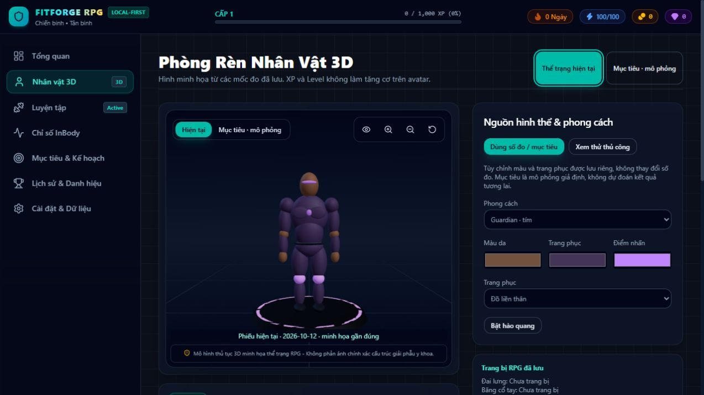

# Phase 4 — 3D Character Evolution Engine

Completed 2026-10-12 on `feature/phase-4-character-evolution`. No push, merge or Phase 5 work was performed.

## Repository audit

- Read Architecture, Handoff, Phase 2/3 reports and inspected the procedural avatar, controls, character store, Phase 3 mapping, database synchronization and validation.
- Initial worktree was clean on `feature/phase-3-inbody-engine`, commit `82258e1`; Phase 3 implementation is `42857f3`.
- Contrary to the request's starting assumption, local `main` and the existing `origin/main` tracking ref were still at Phase 2 commit `0b72284`. No remote fetch was performed. Phase 4 branches from completed Phase 3, preserving that implementation without merging into main.
- Baseline: lint passed, 105 tests passed, production build passed with an existing large-bundle warning.
- Existing avatar was procedural but mostly angular, manually driven, rebuilt geometry during rendering, lacked history/source integration and had no explicit graphics-unavailable fallback. Phase 3 already supplied bounded artistic mappings, live measurement data, goal mappings and independent manual character fields.

## Delivered features

- Improved the existing full-body procedural humanoid using smooth ellipsoid surfaces, coherent articulated limbs/torso, shallow stylized pectoral definition, clothing and visor details. No external models, assets or dependencies were introduced.
- Connected all seven normalized Phase 3 proxies through a legacy-compatible adapter. Finite clamping and conservative final geometry bounds avoid extreme proportions. Exponential frame interpolation smooths changes without React state updates per frame.
- Current Body follows latest actual checkpoints, discloses the measurement date and missing inputs. Goal Preview follows the selected goal and explicitly states it is hypothetical, with no guaranteed result.
- Select an earlier checkpoint, compare two saved dates and review composition differences, then return to latest. Preview selection never writes historical readings.
- Persist Forge/Scout/Guardian appearance presets, three colors, clothing choices and manual previews independently. Returning to measurement view retains saved manual settings. Older character rows remain supported.
- Updated the Dashboard's mini avatar to use current/goal sources while ignoring the history panel's selected date.
- Preserved XP/Level independence: workout XP never modifies checkpoints or mapped physique. Existing aura and equipment preferences remain cosmetic.
- Added 360-degree horizontal orbit, automatic rotation, zoom buttons, camera reset and a responsive viewport. WebGL 2 availability, renderer errors and context loss have a graceful fallback.
- Preserved the application shell, dark RPG design, navigation, local data, workout/PR engine and body engine. Schema/backup version remains 3 with optional validated character fields and no destructive migration.

## Files created or modified

Created:

- `src/services/character/evolution.ts` — mapping adapter, bounds, interpolation, checkpoint/source resolution and presets.
- `src/services/character/webgl.ts` — safe graphics capability probe and probe-context cleanup.
- `src/services/character/evolution.test.ts` — 11 integration/pure-function tests.
- `src/stores/useCharacterStore.test.ts` — 6 persistence, backup and source-separation tests.
- `docs/CHARACTER_EVOLUTION.md`, `docs/PHASE_4_REPORT.md`, `docs/phase-4-character.jpg`.

Modified:

- `src/components/avatar/ProceduralCharacter.tsx`, `AvatarCanvas.tsx`, `AvatarControls.tsx`.
- `src/pages/CharacterPage.tsx`, `src/pages/DashboardPage.tsx`.
- `src/stores/useCharacterStore.ts`, `src/types/character.ts`.
- `src/services/db/DatabaseSync.tsx`, `src/services/db/validation.ts`.
- `README.md`, `docs/ARCHITECTURE.md`, `docs/HANDOFF_TO_CODEX.md`, `docs/FEATURE_ROADMAP.md`.

The original Phase 3 `BodyCompositionToAvatar` implementation is unchanged. See [the character contract](CHARACTER_EVOLUTION.md) for parameter ownership, rendering bounds and backward compatibility.

## Verification

| Check | Result |
| --- | --- |
| `npm.cmd run lint` | Passed, no lint errors |
| `npm.cmd run test` | 122 tests passed across 7 files; all 105 Phase 2/3 tests retained |
| `npm.cmd run build` | Passed TypeScript and Vite production build |
| `git diff --check` | Passed |
| Desktop browser | Full-body rendering, current/goal switching, dated selection/comparison, zoom/reset, auto rotation and manual/preset persistence after reload verified |
| 390 × 844 browser viewport | Full body and wrapped controls visible; canvas width 324 px, document width 384 px; no horizontal overflow |
| Browser errors | No renderer errors; upstream Three.Clock deprecation warning remains |

New tests cover Phase 3 mapping integration, all seven proxies, parameter clamping, interpolation, latest/new/deleted checkpoints, current/goal switching, missing values, demo filtering, manual/appearance separation, saved preferences after reconnect, extended JSON restore, invalid customization rejection and XP independence. Fake IndexedDB tests use isolated test databases; real browser records were not reset or deleted. Browser QA reused explicitly synthetic Phase 3 QA records and changed only character preview/customization preferences.

WebGL unsupported/throwing probes and probe cleanup are unit tested. GPU context loss is handled in code but was not deliberately forced in the browser. No performance benchmark or cross-device GPU certification is claimed.



## Known limitations

- This is a stylized segmented humanoid, not a scan, anatomical reconstruction, diagnosis or guaranteed goal outcome. Small checkpoint changes intentionally produce subtle visual changes. Artistic visual bounds cap extreme heights and dimensions.
- Same-date checkpoints sort by ID; the data model has no measurement time for chronological ordering within a day.
- History/comparison and selected goal IDs are session preferences; mode, appearance and manual bodies persist. Reload returns to latest/default goal.
- A backup containing new optional character fields requires Phase 4 or later to restore; older validators reject those unknown fields. Older backups remain readable by this version.
- Unsupported WebGL 2 or context loss requires restoring browser graphics support and reloading. The data and history UI remain available.
- The existing eager application bundle is approximately 1.84 MB minified / 520 KB gzip and still produces Vite's size warning. DPR is capped and per-frame geometry rebuilds are removed; bundle splitting can be addressed separately.
- Existing Three.js/R3F code emits a Three.Clock deprecation warning. No dependency upgrade was made solely to suppress it.
- Local/offline architecture is preserved; a service worker/PWA installation and advanced game achievements are future scope.

## Run locally

From `D:\RPG`, with the project's supported Node.js installation:

```powershell
npm.cmd ci
npm.cmd run dev
```

Open the displayed local URL and `/character`. Keep the same browser profile and origin to access existing IndexedDB records. Add valid measurements through `/body-analysis` and select personal goals through the existing goal controls. Use Settings JSON export before changing browser profiles or origins.

```powershell
npm.cmd run lint
npm.cmd run test
npm.cmd run build
npm.cmd run preview
```

## Next work, only when authorized

Resolve the branch integration order before any future merge: Phase 3 is not yet present on local main. Potential later work includes bundle splitting, broader GPU verification and independently designed RPG achievement/equipment mechanics. This delivery stops after Phase 4.
