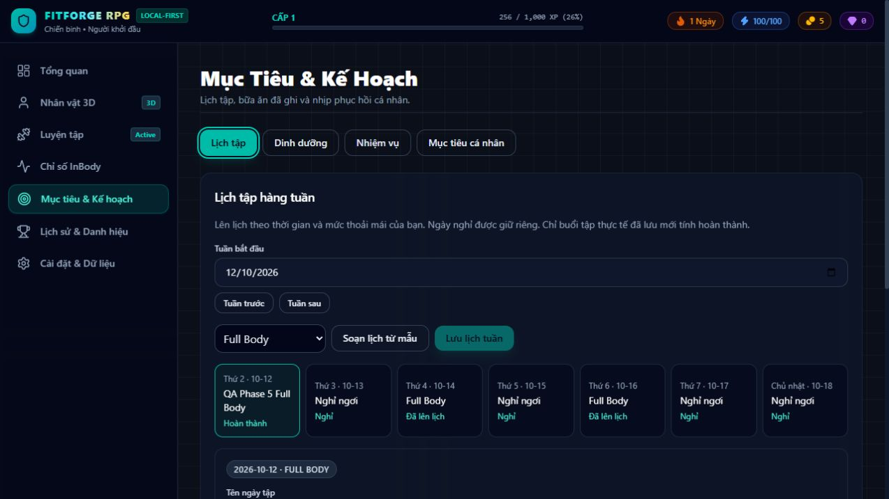

# Phase 5 — RPG Progression & Fitness Planning

Completed 2026-10-12 on `feature/phase-5-rpg-planning`. No push, merge or later phase work was performed.

## Audit and baseline

The working tree was clean on local `main`, whose HEAD was Phase 4 commit `81d4fdabf2f6fd23863a9ac5861f0e07da6842b2`. The requested branch was created from that working baseline. Architecture, Handoff and all existing phase reports were read; workout/store transactions, Dexie validation/restore, character morph ownership, goals and quest/achievement scaffolds were inspected.

Baseline lint, 122 tests and production build passed. Phase 2 already had edit/delete-aware workout XP, but no event ledger. Quests and achievements were empty/display-only, claims were disabled, and Goals had no persistent calendar or meal journal. Existing 3D mapping and physical checkpoints were independent of XP.

## Delivered

1. Persistent append-only XP/gold ledger, deterministic levels, transactional completed-workout awards, edit/delete reversals, legacy carry preservation and duplicate-claim protection. Drafts earn zero. New workout volume bonuses cap at 200 XP above the 200-XP base.
2. Daily workout, weekly three-day consistency and recovery check-in quests. Claims are current-period only and persistent across refresh. Evidence changes reconcile already-claimed awards. No daily training streak requirement, unhealthy-measurement rewards or eating-restriction rewards were added.
3. Four real-workout achievements covering first session, strength-estimate improvement, cumulative volume and sustainable weekly consistency. Earned badges keep their unlock history and grant optional character titles/accent colors.
4. Saved weekly Full Body, Upper/Lower, Push/Pull/Legs and Custom calendars, exercise/set/rep/load editing, rest slots, actual session links, planned draft creation, automatic completion linking and correction when actual dates move or workouts are deleted. Optional conservative rep suggestions require explicit selection and Save.
5. Food/meal/hydration journal with create/edit/confirmed delete, optional unknown nutrient values, daily/weekly logged summaries and persistent age/energy/reminder preferences. Energy entry is opt-in for confirmed adult ages. Unknown/minor ages receive balanced education and cannot create restrictive nutrition/physique targets through Goals. No calorie/macro estimate generator or promised physique timeline was added.
6. Dashboard quests, XP progress and planning/nutrition summaries; Goals tabs for calendar/journal/quests/personal goals; History ledger and earned badges; Character cosmetic reward controls. XP and all nutrition/reward operations remain separate from physique mapping and InBody data.
7. Lightweight shirtless/shorts rendering using the existing procedural geometry; no new models, clothing system, APIs, cloud services or dependencies.
8. Additive Dexie version 4 and validated v4 JSON export/restore, preserving older formats and existing IDs. Ledger coherence is checked before restore, and stale award revisions cannot overwrite existing source corrections.

See [RPG_PLANNING.md](RPG_PLANNING.md) for exact formulas, ownership, age policy, migration and restore semantics.

## Files

Created:

- `src/types/planning.ts`.
- `src/services/rpg/calculations.ts`, `persistence.ts`, `backupValidation.ts`, `calculations.test.ts`.
- `src/services/planning/calculations.ts`, `validation.ts`.
- `src/services/db/phase5.test.ts`.
- `src/components/TrainingPlanner.tsx`, `NutritionJournal.tsx`, `RpgProgression.tsx`, `PlanningSummary.tsx`.
- `docs/RPG_PLANNING.md`, `docs/PHASE_5_REPORT.md`, `docs/phase-5-planner.jpg`, `docs/phase-5-mobile-nutrition.jpg`.

Modified:

- `src/services/db/db.ts`, `validation.ts`, `DatabaseSync.tsx`.
- `src/types/index.ts`, `achievement.ts`, `workout.ts`; `src/stores/useWorkoutStore.ts`.
- `src/App.tsx`; Dashboard, GoalsPlanning, HistoryAchievements, Character, Workout and Settings pages.
- `src/components/avatar/ProceduralCharacter.tsx`, `src/components/layout/TopBar.tsx`.
- `src/services/db/bodyMeasurements.test.ts`, `db.test.ts`: version assertions/fixtures updated for v4 and stricter ledger validation, retaining prior preservation/rollback checks.
- README, Architecture, Handoff, Roadmap and Character Evolution documentation.

## Verification

| Check | Result |
| --- | --- |
| `npm.cmd run lint` | Passed |
| `npm.cmd run test` | 160 tests across 9 files passed |
| `npm.cmd run build` | Strict TypeScript and Vite production build passed |
| Prior phases | All 122 existing tests retained; version/restore fixtures adapted to the new contract |
| New tests | 38 tests: XP/levels, repeats/concurrent claims, corrections/deletions, weekly/recovery quests, achievements, plan persistence/drafts/links, optional suggestions, journal/age validation, cosmetics separation, v3→v4 migration, legacy balances, JSON merge/coherence and transaction rollback |
| Browser desktop | Saved calendar and workout draft, 206 workout XP, one 50-XP daily claim surviving refresh (256 total), completion link, adult meal save/reload, minor safeguards, title/accent application, Dashboard/History live records verified |
| Browser mobile | 390 × 844 calendar and journal views, mobile menu navigation, hydration entry and 550-ml logged summary verified; document width at or below viewport width |
| Browser error logs | No captured errors |

Browser QA reused the existing synthetic localhost profile/checkpoints. Added one labelled QA workout/calendar and two labelled synthetic journal entries; no actual measurement or workout records were deleted or reset. Age preferences were tested at 17 and 25; the QA profile remains at 25 with optional energy logging enabled. Destructive rollback/deletion cases ran only in isolated fake IndexedDB test databases. The screenshots show synthetic test records, not user progress.



[Mobile nutrition verification](phase-5-mobile-nutrition.jpg)

## Limitations

- One active local profile remains the application model. Legacy workout ownership is assigned to the first real profile; multi-profile switching and collaboration are not implemented.
- Recovery is a personal check-in, and meal values/age are user-entered. No food database, barcode lookup, clinical nutrition prescription or adult energy/macro estimation is included. Journal totals describe logged portions only.
- Hydration reminders are in-app text, not scheduled OS notifications. Planning templates are editable schedules, not personalized load prescriptions. Historical non-planner workouts can be linked manually.
- Earned cosmetics remain unlocked after record corrections, while their current progress and dependent quest XP can decrease. This policy preserves achievement history.
- History shows the most recent 50 ledger events; the full ledger remains stored and included in JSON export. Reconciliation scans workout/quest history; very large histories need separate optimization.
- Existing IDs win during restore; there is no conflict-resolution editor. Older applications cannot restore new v4 fields. Browser profile/origin changes use separate storage.
- The existing eager bundle warning remains: approximately 1.88 MB minified / 531 KB gzip. The existing upstream Three.Clock warning remains. No new renderer geometry or dependency upgrade was introduced.
- No service worker/PWA, cloud sync or background job infrastructure was added. Development hot reload can briefly reset store previews; a full refresh restores persisted records. Production/browser refresh persistence was verified.

## Run locally

From PowerShell in `D:\RPG`:

```powershell
npm.cmd ci
npm.cmd run dev
```

Use the displayed local URL and keep the same browser profile, host and port for existing data. Open `/goals` for Lịch tập, Dinh dưỡng and Nhiệm vụ; `/history` for awards/events; `/character` to apply earned cosmetics. Save a calendar before opening its planned workout. Add actual meals without treating logged totals as restrictive targets. Export JSON from Settings periodically.

```powershell
npm.cmd run lint
npm.cmd run test
npm.cmd run build
npm.cmd run preview
```

This delivery stops after Phase 5. No subsequent phase has been started.
